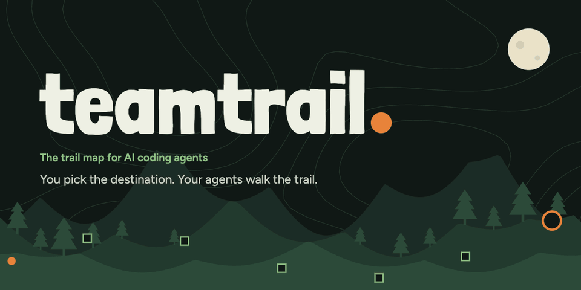

# Teamtrail

**The trail map for your AI coding agents.** You pick the destination, your agents walk the trail, and you only get the calls that need you.

**[teamtrail.app](https://teamtrail.app)** · [Docs](https://teamtrail.app/docs/) · [GitHub](https://github.com/teamtrailhq/teamtrail)

Teamtrail is a local trail map for big work done by AI coding agents. You describe a trail, your agents chart it as decision tickets, and they claim the work over MCP while you steer from the Lookout, a web app on your machine.

- **Trails and decision tickets:** a live map of what's decided, in progress, blocked and out of scope.
- **Waiting on you:** every question from every agent in one inbox, ranked by what matters.
- **Scout:** briefs you when you come back and only calls you for the turns that are yours to make.
- **Verified outcomes:** acceptance criteria tied to evidence, so "done" means proven.
- **Local-first:** trails are plain markdown in `./.teamtrail/` in your repo, or in your GitHub Issues or Linear. Nothing needs a Teamtrail server.

Works with any coding agent that connects over MCP. Claude Code and Codex are the primary supported agents.

## Try it

The public release isn't out yet, so this package is a placeholder. The preview is on the `next` tag:

```bash
cd your-repo
npx teamtrail@next
```

## License

[FSL-1.1-ALv2](LICENSE): free to use, modify and run, including at work, for anything except a competing product. Each release becomes Apache 2.0 two years after it ships.
