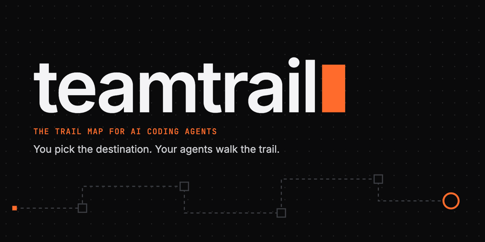

# Teamtrail

**The control layer for AI coding agents.** Agents do the work, you make the calls, and nothing counts as done without evidence.

**[teamtrail.app](https://teamtrail.app)** · [Docs](https://teamtrail.app/docs/) · [GitHub](https://github.com/teamtrailhq/teamtrail)

Your agents can already write the code, and plenty of tools run them side by side. Teamtrail adds what they don't: it breaks big work into decision tickets your agents pick up over MCP, keeps the important calls yours, and won't let an agent call anything done without evidence. You steer from the Lookout, a web app on your machine.

- **Your calls, by rule:** choose what always comes to you (database changes, logins, billing, deleting data). Agents can't record those decisions themselves; it's enforced in code, not in a prompt.
- **Done means proven:** acceptance criteria agreed up front, your tests run by Teamtrail itself, and a review by a different agent.
- **Every call on the record:** each decision keeps the question, your words, the alternatives and who made it.
- **One queue for what needs you:** every question from every agent, ranked by what matters. Scout briefs you when you come back.
- **Local-first:** trails are plain markdown in `./.teamtrail/` in your repo, or in your GitHub Issues or Linear. Nothing needs a Teamtrail server.

Works with any coding agent that connects over MCP. Claude Code and Codex are the primary supported agents.

## Try it

The public release isn't out yet, so this package is a placeholder. The preview is on the `next` tag:

```bash
cd your-repo
npx teamtrail@next
```

## License

[MIT](LICENSE).
