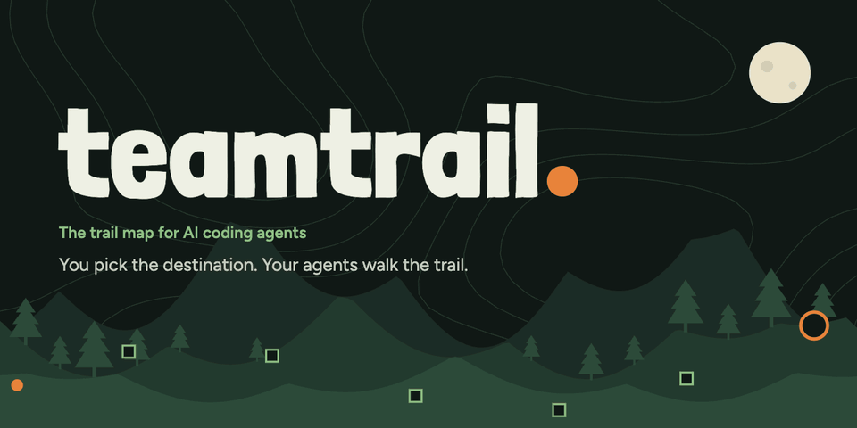

# Teamtrail

> You pick the destination. Your agents walk the trail.

[](https://github.com/teamtrailhq/teamtrail/actions/workflows/ci.yml)
[](https://www.npmjs.com/package/teamtrail?activeTab=versions)
[](https://nodejs.org)
[](https://modelcontextprotocol.io)
[](packages/cli/README.md#connect-your-coding-agent)
[](LICENSE)
[](https://github.com/teamtrailhq/teamtrail/stargazers)

**[teamtrail.app](https://teamtrail.app)** · [Docs](https://teamtrail.app/docs/) · [Try it: `npx teamtrail@next`](https://www.npmjs.com/package/teamtrail?activeTab=versions)

Teamtrail is a local trail map for planning and executing big work with your AI coding agents. You describe a trail; your agents chart it as decision tickets, work through them, and bring the calls that need you to a single inbox. Scout, the Lookout's trail lead, briefs you on what changed while you were away and keeps spend and token usage in view.

- **Trails and decision tickets:** a live map of what's decided, in progress, blocked and out of scope.
- **Waiting on you:** every question from every agent, in one inbox, answered in-window.
- **Decision records:** each call is written down with its alternatives, rationale and transcript.
- **Live spend:** per-session and per-trail tokens and cost.
- **Your data stays yours:** trails are plain markdown in `./.teamtrail/` in your repo. Nothing leaves your machine unless you connect Slack.

Works with any coding agent that connects over MCP. Claude Code and Codex are the primary supported agents.

## Why Teamtrail

Your agents can already write the code. What's missing is a place to run them like a team: one where you set the direction, they do the work, and you make the calls that matter.

- **Bring any agent.** Everything runs through MCP tools. Claude Code today, Codex tomorrow, both at once. Teamtrail never calls a model itself and never locks you into a vendor.
- **Local-first, for real.** Trails live as plain files in your repo's `.teamtrail/` folder, or in the GitHub Issues or Linear tracker you already use. Nothing needs a Teamtrail server. Slack is optional: its questions, answers and digests pass through Teamtrail's Scout service, but your trails, decisions and approvals never leave your machine.
- **A deterministic core.** Lifecycle, state and ranking are code, not prompts. The same inputs always give the same result, so you can trust what the map tells you.
- **Evidence over claims.** Agents bring the decisions that matter to you, with the alternatives and the reasoning, and you decide. Less babysitting, not less judgment.
- **Not another activity feed.** Teamtrail isn't a prettier log of what agents did. It's where work gets steered.

## Features

**Plan and steer**

- **Trails and decision tickets:** research, prototype, junction, task, execute and review tickets with blocking edges, on a live map.
- **Discovery first:** by default, agents write a brief you accept before implementation starts, and each ticket's acceptance criteria need evidence when the work is done.
- **Plans that adapt:** a trail lists the assumptions it relies on. When an agent finds one is wrong, it shows the evidence and proposes a new route; nothing changes until you approve.
- **Project knowledge:** what agents learn about your product is kept as entries you confirm, committed so your team shares them.

**Only what needs you**

- **Waiting on you:** one ranked list of questions, approvals, blocked work, briefs and new plans, each with the reason it's there. Focus for an hour, set quiet hours, and the rest waits in a digest.
- **Risk policy:** you decide what always needs you (database changes, auth, billing, deleting data, new dependencies). Agents can't make those calls on their own.
- **Away briefing:** Scout tells you what changed while you were away.
- **Scout in Slack:** answer agents' questions and approve work from Slack, and ask Scout things like “what's blocking #12?”, “what did we decide about retention?” or “who's working?”. High-risk calls are answered in the Lookout only.

**Many agents at once**

- **Separate workspaces:** each claimed ticket can get its own git worktree and branch. Agents say which files they'll change, you're warned before two collide, and a ticket to bring the work together is one click away. Teamtrail never merges or pushes for you.
- **Model matching:** per trail, each agent gets the tickets that fit the model it runs on, from research on fast models to junctions on the strongest. Teamtrail never picks or switches a model.
- **Guides:** a ticket can ask for a reviewer, QA, security, docs or architect guide, with a checklist the agent must answer before the work counts. Add more from a moderated catalog, or write your own with `teamtrail guides new`.
- **Remote agents:** agents on other machines or in cloud sandboxes join over HTTP (`teamtrail mcp --http`), each with a token you can revoke.

**Evidence you can trust**

- **Checks before done:** completions run your project's checks and collect git evidence; PR and CI status sync back to the ticket.
- **Decision records:** the question, answer, alternatives, rationale and transcript, and who actually decided. An agent's own call is never shown as yours.
- **Approvals on this machine:** check commands, briefs, criteria, guides and settings only take effect once you approve them here, and edits to trail files made outside Teamtrail wait until you accept them.
- **Signed-in Lookout:** the browser signs in with a one-time link, and you can pair your phone with a QR code.

**Across projects**

- **All projects:** every repo you supervise in one Lookout, with one list of what needs you across them.
- **Your tracker:** local markdown files, GitHub Issues or Linear.
- **Trail stats and live spend:** delivery by vendor, agent and ticket type, and tokens and cost per session and trail.

## What's next

**Teamtrail Cloud:** agents that run in the cloud, steered from the same Lookout. It will be optional: everything local keeps working without it.

## Install

Requires Node 20+.

```bash
cd your-repo
npx teamtrail@next      # or install it: npm i -g teamtrail@next, then run `teamtrail`
```

Use `@next` until launch: npm's `latest` tag is still a placeholder that only says Teamtrail isn't released yet.

`teamtrail` opens the Lookout in your browser. Run `teamtrail --help` for options.

Connect your agent once, then use `/scout new "<idea>"`, `/scout resume`, `/scout status` and `/scout inbox`:

```bash
npx teamtrail@next connect claude   # Claude Code: the MCP server and the /scout command
npx teamtrail@next connect codex    # Codex: the MCP server and the /prompts:scout prompt
```

`connect` pins your agent to the version you ran it with.

Details for both agents are in [`packages/cli/README.md`](packages/cli/README.md#connect-your-coding-agent).

## Repository

| Path | Package | |
| --- | --- | --- |
| [`packages/core`](packages/core) | `@teamtrail/core` | UI-free engine: trails, tickets, trackers, metrics, decision records |
| [`packages/cli`](packages/cli) | [`teamtrail`](https://www.npmjs.com/package/teamtrail) | The `teamtrail` command: serves the Lookout and the tracker API |
| [`packages/scout-avatar`](packages/scout-avatar) | `@teamtrail/scout-avatar` | Pixel-art Scout avatar (React component and framework-free renderer) |
| [`apps/lookout`](apps/lookout) | private | The lookout web UI bundled into the CLI |
| [`brand`](brand) | | Logos, avatars and social images |

The landing site lives in [teamtrailhq/teamtrail-landing](https://github.com/teamtrailhq/teamtrail-landing).

## Develop

```bash
npm install
npm run dev           # resets the dev project to the seed, then the Lookout with hot reload
npm run dev:agent     # real MCP agents working the dev project (after npm run build -w teamtrail)
npm run dev:empty     # the Lookout on a brand-new empty folder: the first-run, no-trail flow
npm run typecheck     # every workspace
npm test              # unit and MCP tests (vitest)
npm run verify:mcp    # after a build: an MCP client drives a trail while the Lookout shows it
npm run build         # every workspace; the CLI lands in packages/cli/dist
npm start             # run the built CLI (same as `teamtrail`)
npm run lint          # ESLint across the monorepo
npm run check         # lint, typecheck, build, test and verify:mcp; run before opening a PR
```

See [`apps/lookout/README.md`](apps/lookout/README.md) for the architecture, metrics and tracker API, and [`CONTRIBUTING.md`](CONTRIBUTING.md) for code standards.

## Support

<a href="https://www.teamtrail.app/scout/"></a>

Teamtrail is free. If it helps you, [sponsor it on GitHub](https://github.com/sponsors/teamtrailhq). At the Scout tier, a handmade Scout plush comes home with you: [adopt a Scout](https://www.teamtrail.app/scout/).

<br clear="right">

## License

[FSL-1.1-ALv2](LICENSE) (Functional Source License, Apache 2.0 future license): free to use, modify and run, including at work, for anything except a competing product. Each release becomes Apache 2.0 two years after it ships. Third-party credits are in [`THIRD_PARTY_NOTICES.md`](THIRD_PARTY_NOTICES.md).
