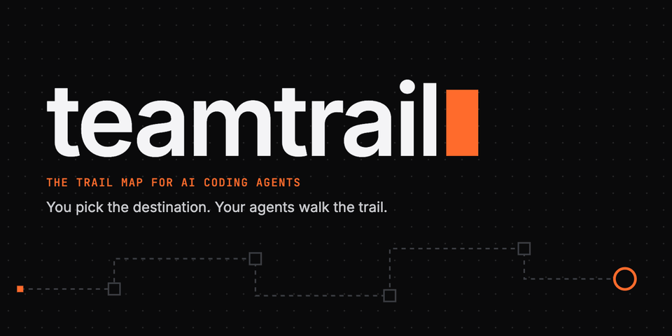

# Teamtrail

> Many agents, one big project. Every piece verified.

[](https://github.com/teamtrailhq/teamtrail/actions/workflows/ci.yml)
[](https://www.npmjs.com/package/teamtrail)
[](https://nodejs.org)
[](https://modelcontextprotocol.io)
[](packages/cli/README.md#connect-your-coding-agent)
[](LICENSE)
[](https://github.com/teamtrailhq/teamtrail/stargazers)

**[teamtrail.app](https://teamtrail.app)** · [Docs](https://teamtrail.app/docs/) · [Try it: `npx teamtrail`](https://www.npmjs.com/package/teamtrail)

Teamtrail gives you verified work from AI coding agents. It breaks big work into decision tickets that Claude Code, Codex or any MCP agent picks up, sends you only the calls that are yours, and counts nothing as done until it's verified: your checks, run by Teamtrail, a review by an agent on another model, the whole trail checked again on main, and a signed proof for every finished ticket. You steer from the Lookout, a web app on your machine, where Scout briefs you on what changed while you were away.

- **Your calls, by rule:** a risk policy in your repo sets what always comes to you (database changes, logins, billing, deleting data). Agents can't record those decisions themselves; it's enforced in code, not in a prompt.
- **Done means proven:** acceptance criteria agreed up front, your tests run by Teamtrail itself, a review by an agent on another model, and the whole trail verified together on main once it's merged.
- **Every call on the record:** each decision keeps the question, your words, the alternatives and who made it, long after the agent's session is gone.
- **One queue for what needs you:** every question and approval from every agent and repo, ranked with a reason, with focus hours and Slack.
- **Your data stays yours:** trails are plain markdown in `./.teamtrail/` in your repo. Nothing leaves your machine unless you connect Slack.

Works with any coding agent that connects over MCP. Claude Code and Codex are the primary supported agents.

## Why Teamtrail

Your agents can already write the code, and plenty of tools run them side by side. What's missing is control: a place where you set the direction, they do the work, the calls that matter stay yours, and "done" means proven.

- **Bring any agent.** Everything runs through MCP tools. Claude Code today, Codex tomorrow, both at once. Teamtrail never calls a model itself and never locks you into a vendor.
- **Local-first, for real.** Trails live as plain files in your repo's `.teamtrail/` folder, or in the GitHub Issues or Linear tracker you already use. Nothing needs a Teamtrail server. Slack is optional: its questions, answers and digests pass through Teamtrail's Scout service, but your trails, decisions and approvals never leave your machine.
- **A deterministic core.** Lifecycle, state and ranking are code, not prompts. The same inputs always give the same result, so you can trust what the map tells you.
- **Evidence over claims.** Agents bring the decisions that matter to you, with the alternatives and the reasoning, and you decide. Less babysitting, not less judgment.
- **Not another activity feed.** Teamtrail isn't a prettier log of what agents did. It's where work gets steered.

## Agents write more code. Review is where it waits.

A Harvard study of 655 companies[\*](#source) found that after teams adopted coding agents, pull requests went up by a third, while finished issues barely moved. The code waited for someone to review it.

- **+36% pull requests opened.** Agents made writing code cheap. The volume went up right away.
- **+14% issues resolved.** What actually shipped grew far less, and not by a statistically significant amount.
- **+56% time to approval.** Code waited longer for a reviewer, and took longer to review once it got one.

Teamtrail paces agents to your review:

- **Review limit: new work waits for your review.** Set how many finished tickets may wait for you. Once they do, agents start no new work: they fix what came back and keep researching until you've reviewed some. Waiting on you opens the one waiting longest.
- **Scope check: see the code nobody asked for.** Agents say which files they'll change when they take a ticket. Anything they change beyond that is listed first for the reviewer and on the proof, or sent back, as you choose.

[How it works](https://teamtrail.app/docs/review-capacity/)

## Features

**Plan and steer**

- **Trails and decision tickets:** research, prototype, junction, task, execute and review tickets with blocking edges, on a live map.
- **Discovery first:** by default, agents write a brief you accept before implementation starts, and each ticket's acceptance criteria need evidence when the work is done.
- **Plans that adapt:** a trail lists the assumptions it relies on. When an agent finds one is wrong, it shows the evidence and proposes a new route; nothing changes until you approve.
- **Project knowledge:** what agents learn about your product is kept as entries you confirm, committed so your team shares them.

**Only what needs you**

- **Waiting on you:** one ranked list of questions, approvals, blocked work, briefs and new plans, each with the reason it's there. Focus for an hour, set quiet hours, and the rest waits in a digest.
- **Risk policy:** you decide what always needs you (database changes, auth, billing, deleting data, new dependencies). Agents can't make those calls on their own.
- **Away briefing:** Scout tells you what changed while you were away.
- **Scout in Slack:** answer agents' questions and approve work from Slack, and ask Scout things like “what's blocking #12?”, “what did we decide about retention?” or “who's working?”. High-risk calls are answered in the Lookout only.

**Many agents at once**

- **Separate workspaces:** each claimed ticket can get its own git worktree and branch. Agents say which files they'll change, you're warned before two collide, and a ticket to bring the work together is one click away. Teamtrail never merges or pushes for you.
- **Model matching:** per trail, each agent gets the tickets that fit the model it runs on, from research on fast models to junctions on the strongest. Teamtrail never picks or switches a model.
- **Guides:** tickets take guides by type (the architect on research, QA and security on tasks, the reviewer on reviews), each with a checklist the agent must answer before the work counts. Change them per trail or per ticket, add more from a moderated catalog, or write your own with `teamtrail guides new`.
- **Remote agents:** agents on other machines or in cloud sandboxes join over HTTP (`teamtrail mcp --http`), each with a token you can revoke.

**Evidence you can trust**

- **Checks before done:** completions run your project's checks and collect git evidence; PR and CI status sync back to the ticket.
- **Checks the work can't game:** a pass doesn't count when the work changed what the check runs, skipped or deleted tests, or passed only on a retry. Rules you write ask agents about the files they touch, each with the reason behind it. Try each gate in Observe before it holds anything.
- **The trail, verified together:** once every ticket is merged, your checks run again on main; the trail is verified only when that passes.
- **Paced to your review:** set how many finished tickets may wait for your review, and agents start no new work past it; they fix what came back and keep researching. Files an agent changes beyond the ones it said it would are listed first for the reviewer and on the proof, or sent back, as you choose.
- **Verified by Teamtrail:** each done ticket gets a signed proof report (the checks Teamtrail ran, criteria verified or only claimed, the review and the decisions it relies on). Teamtrail can post it on the ticket's pull request with a `Teamtrail proof` commit status, and a GitHub Action checks every proof on a PR against your committed keys.
- **Decision records:** the question, answer, alternatives, rationale and transcript, and who actually decided. An agent's own call is never shown as yours.
- **Decision memory:** before an agent asks you something you already decided, it gets your earlier decision instead, and later work that changes what a decision covers is flagged for you.
- **Approvals on this machine:** check commands, briefs, criteria, guides and settings only take effect once you approve them here, and edits to trail files made outside Teamtrail wait until you accept them.
- **Signed-in Lookout:** the browser signs in with a one-time link, and you can pair your phone with a QR code.

**Across projects**

- **All projects:** every repo you supervise in one Lookout, with one list of what needs you across them.
- **Your tracker:** local markdown files, GitHub Issues or Linear.
- **Trail stats and live spend:** delivery by vendor, agent and ticket type, a Scorecard of how each model, agent and vendor does on your own tickets (verified first time, rework, cost per verified ticket, and verified work that came back), and tokens and cost per session and trail.

## What's next

**Teamtrail Cloud:** agents that run in the cloud, steered from the same Lookout. It will be optional: everything local keeps working without it.

## Install

Requires Node 20+.

```bash
cd your-repo
npx teamtrail      # or install it: npm i -g teamtrail, then run `teamtrail`
```

`teamtrail` opens the Lookout in your browser. Run `teamtrail --help` for options.

Connect your agent once, then use `/scout new "<idea>"`, `/scout resume`, `/scout status` and `/scout inbox`:

```bash
npx teamtrail connect claude   # Claude Code: the MCP server and the /scout command
npx teamtrail connect codex    # Codex: the MCP server and the /prompts:scout prompt
```

`connect` pins your agent to the version you ran it with.

Details for both agents are in [`packages/cli/README.md`](packages/cli/README.md#connect-your-coding-agent).

## Repository

| Path | Package | |
| --- | --- | --- |
| [`packages/core`](packages/core) | `@teamtrail/core` | UI-free engine: trails, tickets, trackers, metrics, decision records |
| [`packages/cli`](packages/cli) | [`teamtrail`](https://www.npmjs.com/package/teamtrail) | The `teamtrail` command: serves the Lookout and the tracker API |
| [`packages/connector-slack`](packages/connector-slack) | `@teamtrail/connector-slack` | Optional Slack connector: questions, approvals and briefings through Scout |
| [`packages/scout-avatar`](packages/scout-avatar) | `@teamtrail/scout-avatar` | The Teamtrail logo and Scout's badge (React components and a framework-free renderer) |
| [`apps/lookout`](apps/lookout) | private | The lookout web UI bundled into the CLI |
| [`apps/scout-service`](apps/scout-service) | private | The Scout service: the backend of Teamtrail's Slack app, deployed separately |
| [`actions/proof`](actions/proof) | | The Verified by Teamtrail GitHub Action |
| [`brand`](brand) | | Logos, avatars and social images |

The landing site lives in [teamtrailhq/teamtrail-landing](https://github.com/teamtrailhq/teamtrail-landing).

## Develop

```bash
npm install
npm run dev           # resets the dev project to the seed, then the Lookout with hot reload
npm run dev:agent     # real MCP agents working the dev project (after npm run build -w teamtrail)
npm run dev:empty     # the Lookout on a brand-new empty folder: the first-run, no-trail flow
npm run typecheck     # every workspace
npm test              # unit and MCP tests (vitest)
npm run verify:mcp    # after a build: an MCP client drives a trail while the Lookout shows it
npm run build         # every workspace; the CLI lands in packages/cli/dist
npm start             # run the built CLI (same as `teamtrail`)
npm run lint          # ESLint across the monorepo
npm run check         # lint, typecheck, build, test and verify:mcp; run before opening a PR
```

See [`apps/lookout/README.md`](apps/lookout/README.md) for the architecture, metrics and tracker API, and [`CONTRIBUTING.md`](CONTRIBUTING.md) for code standards.

## License

[MIT](LICENSE). Third-party credits are in [`THIRD_PARTY_NOTICES.md`](THIRD_PARTY_NOTICES.md).

---

<a id="source"></a>\* Chen and Stratton, _Artificial Intelligence in the Firm: Bottlenecks in Software Production_, Harvard, November 2026. Effects 12 months after firms adopted AI coding agents.
