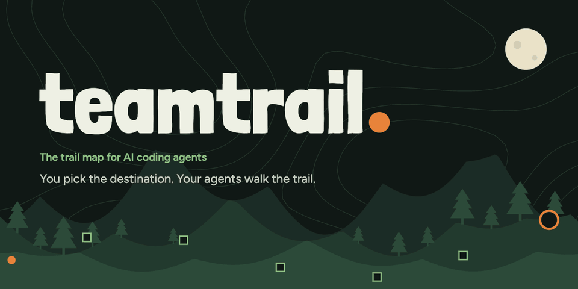

# teamtrail

**The trail map for your AI coding agents.** You pick the destination, your agents walk the trail, and you only get the calls that need you. One command opens it for the agents working in your repo.

**[teamtrail.app](https://teamtrail.app)** · [Docs](https://teamtrail.app/docs/) · [GitHub](https://github.com/teamtrailhq/teamtrail)

```bash
npm i -g teamtrail      # or skip the install: npx teamtrail
cd your-repo
teamtrail
```

`teamtrail` starts a local server, opens the Lookout in your browser and keeps trails as markdown in `./.teamtrail/` in the current folder. Commit that folder or ignore it; agents and people can edit the files directly, and changes show up live.

| Option | Default | |
| --- | --- | --- |
| `--dir <path>` | `./.teamtrail` (or `$TEAMTRAIL_DIR`) | Tracker folder |
| `--port <n>` | `7420`, next free port if taken | Port |
| `--host <addr>` | `127.0.0.1` | Interface to bind. The server can write files in the tracker folder, so only expose it on networks you trust. |
| `--no-open` | | Don't open the browser |

Requires Node 20 or newer. No other runtime dependencies.

## Connect your coding agent

The same package ships an MCP server, `teamtrail mcp`, that your agent starts over stdio. Nothing else to install. Run `teamtrail` in the repo as well to watch the agent live and answer its questions in the Lookout.

### Claude Code

```bash
claude mcp add teamtrail -- npx -y teamtrail mcp
```

Or let `teamtrail` do it and add the `/scout` command to the repo (`.claude/commands/scout.md`):

```bash
npx teamtrail connect claude
```

Then, in Claude Code:

| Command | Does |
| --- | --- |
| `/scout new "<idea>"` | Frames the idea with you, then charts a trail |
| `/scout resume [trail]` | Picks up the trail and works ready tickets |
| `/scout status` | Progress, running sessions, what's waiting and blocked, spend |
| `/scout inbox` | Questions waiting on you; answer them in the chat |

### Codex

```bash
codex mcp add teamtrail -- npx -y teamtrail mcp
```

or in `~/.codex/config.toml`:

```toml
[mcp_servers.teamtrail]
command = "npx"
args = ["-y", "teamtrail", "mcp"]
# ask_human waits for your answer; Codex cancels tool calls after 60 s by default.
tool_timeout_sec = 900
```

`npx teamtrail connect codex` prints this and installs the same command as a Codex prompt (`~/.codex/prompts/scout.md`): `/prompts:scout new "<idea>"`, `/prompts:scout resume`, and so on.

### Other agents

Any MCP client works: run `npx -y teamtrail mcp` over stdio in the repo. `--dir <path>` (or `$TEAMTRAIL_DIR`) picks another tracker folder; `--agent <trail name>` fixes the session name, which otherwise comes from the client (`claude-01`, `codex-01`).

### Agents on other machines

An agent on another machine or in a cloud sandbox reaches the same trails over HTTP. On the machine with the repo:

1. Create a token for the agent in the Lookout: Settings → Remote agents. It's shown once; only its hash is kept, in `.teamtrail/.agents/` (never committed).
2. Serve the tools: run `npx teamtrail mcp --http` (port 7421, path `/mcp`). It serves the agent tools and nothing else; without a token every request gets a 401. The running Lookout also answers at `/mcp` on its own port, but only to clients on the same machine.
3. On the agent's machine, with the token in `$TEAMTRAIL_TOKEN`:

```bash
npx -y teamtrail connect claude --url https://trail.example.com/mcp   # or: connect codex --url …
```

`--token-stdin` and `--token <token>` work too. Claude Code keeps the token in its own config; Codex only stores the variable's name and reads `$TEAMTRAIL_TOKEN` when it starts. `connect` checks the token against the endpoint, except over plain HTTP to another machine, where the check itself would send it unencrypted: use https, or pass `--allow-http`.

The connection is plain HTTP and binds to `127.0.0.1` unless you pass `--host`. Before agents elsewhere use it, put the `mcp --http` port behind HTTPS (a reverse proxy or a tunnel) and pass `--allow-host <name>` with the host name they'll use. The Lookout's own port is not for sharing: it has no sign-in, so its `/mcp` answers the machine itself only, and its API refuses a `Host` that isn't `localhost` or an IP address. Another device on your network that opens the Lookout by IP can read, answer and approve, but can't change what runs on the machine or whom it trusts: tokens, the tracker connection (and anything looked up with its credentials), Slack, the risk policy, verification levels, workspaces, guides, attention preferences and the projects list are set on the machine itself, and what that device reads leaves out absolute paths and the tracker account. A token only opens the agent tools, at most 8 sessions at a time, and revoking it in Settings ends them within a second.

The risk policy acts on what an agent declares: a decision is held for you when the agent names a high-risk category or files that match your path rules. An agent that declares nothing is not caught by it. So give an agent you don't fully trust only trails where you review the work: verification on, where every remote completion comes to you.

With GitHub Issues or Linear as the tracker, what a remote agent writes (tickets, comments, closing) goes to the tracker with your credentials, as it does for local agents.

A remote agent can't speak for you. Over HTTP there is no `answer_question`; `start_trail` can't skip discovery; `update_trail` can't change the mode or the destination; and a ticket that needs you (junction, prototype, HITL task) closes only after you answered the agent's question in the Lookout or Slack. Local stdio agents are unchanged.

A remote agent's files aren't on your machine, so it gets no worktree, and on trails with verification its completions come to you for review instead of running the checks locally.

### Tools

| Tool | |
| --- | --- |
| `status` | Trails, progress, ready / claimed / blocked tickets, sessions, waiting questions, decisions, spend |
| `start_trail` | Create a trail: destination, notes, decided, not yet specified, out of scope, tickets with blocking edges |
| `resume_trail` | Open a session on a trail; returns status, your claim and the next ready ticket |
| `update_trail` | Edit destination or notes, add Not yet specified / Out of scope lines, switch mode |
| `next_ticket` | The next ready ticket with its blockers' decisions (does not claim) |
| `claim_ticket` / `release_ticket` | Assign a ticket to the agent (next ready by default) / give it back |
| `add_ticket` | Add a ticket or promote a Not yet specified line |
| `report_progress` | Step, log line, chat message; tokens and cost only when no agent log is read (see Usage) |
| `close_ticket` | Resolve (or rule out) a ticket: resolution comment, close, DecisionRecord, unblocked tickets |
| `record_decision` | Keep any other decision as a DecisionRecord |
| `ask_human` / `wait_for_answer` | Ask the human through the Lookout inbox and wait for the answer |
| `list_inbox` / `answer_question` | Questions from every agent; answer one with the human's words from the chat |

Sessions, questions and usage reach the Lookout through `.teamtrail/.agents/`, so the agent and the Lookout can start in any order.

### Claims are leases

A claim lasts 15 minutes and every tool call from the claiming agent renews it (so do waits on `ask_human`). If the agent crashes or goes silent, the lease expires and the ticket goes back to the queue: the Lookout checks every 15 s, and so does any agent calling `next_ticket` or `claim_ticket`. The ticket gets a **Returned to queue** comment with the agent's `report_progress` notes and decisions, and the next agent's `claim_ticket` returns it as `resume`. The return is an ordinary tracker write (comment + unassign), so on GitHub and Linear it goes through the offline outbox like any other write. Tickets close to expiry show as **Stalled** in the Lookout, which can also release them by hand. Set the length with `--lease-minutes <n>` or `$TEAMTRAIL_LEASE_MINUTES`.

### Usage

Tokens and cost per session are measured from the agent's own local logs, priced at list rates, and tagged `LOG` in the sessions area:

- **Claude Code:** the session transcript (`~/.claude/projects/<project>/<session>.jsonl`). `connect claude` also adds a silent `SessionStart` hook to `.claude/settings.local.json` that records which transcript belongs to the repo.
- **Codex:** the session rollout (`~/.codex/sessions/YYYY/MM/DD/rollout-*.jsonl`), found from the tool call's thread id. Nothing to install.

Other agents report usage through `report_progress`; those numbers are tagged `SELF`. Nothing leaves your machine.

Concepts derived from mattpocock/skills (MIT); see `THIRD_PARTY_NOTICES.md`.
