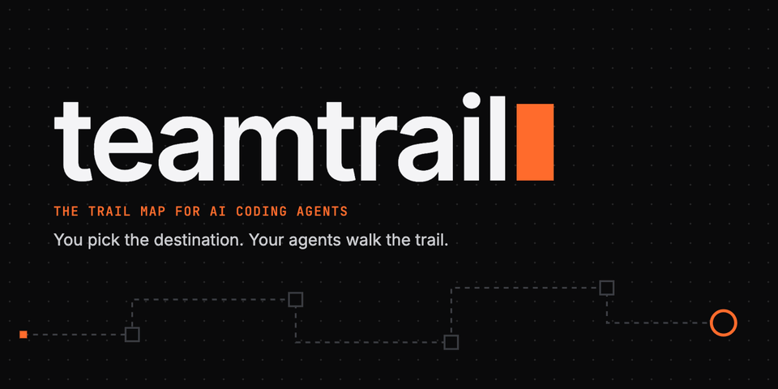

# teamtrail

**Many agents, one big project. Every piece verified.** Agents do the work, you make the calls, and nothing counts as done until it's verified. Teamtrail breaks big work into decision tickets for Claude Code, Codex or any MCP agent, sends you only the calls that are yours, and runs your tests before anything is done.

**[teamtrail.app](https://teamtrail.app)** · [Docs](https://teamtrail.app/docs/) · [GitHub](https://github.com/teamtrailhq/teamtrail)

## Start

Requires Node 20 or newer.

```bash
cd your-repo
npx teamtrail      # or install it: npm i -g teamtrail, then run `teamtrail`
```

`teamtrail` opens the Lookout in your browser at `http://127.0.0.1:7420/`, signed in with one click, and keeps trails as plain markdown in `./.teamtrail/`. Run `teamtrail --help` for options.

More: [Install](https://teamtrail.app/docs/install/) · [CLI commands](https://teamtrail.app/docs/cli/) · [Sign in to the Lookout](https://teamtrail.app/docs/sign-in/) · [Your first trail](https://teamtrail.app/docs/first-trail/)

## Connect your coding agent

The same package is the MCP server your agent starts. Connect once in the repo:

```bash
npx teamtrail connect claude   # Claude Code: the MCP server and the /scout command
npx teamtrail connect codex    # Codex: the MCP server and the /prompts:scout prompt
```

Then, in your agent:

| Command | Does |
| --- | --- |
| `/scout new "<idea>"` | Frames the idea with you, then charts a trail |
| `/scout resume [trail]` | Picks up the trail and works ready tickets |
| `/scout status` | Progress, what's waiting and blocked, spend |
| `/scout inbox` | Questions waiting on you |

`connect` pins your agent to the version you ran it with, and keeps it out of Teamtrail's config folder. Any other MCP client works too: run `npx -y teamtrail mcp` over stdio in the repo.

More: [Connect your agent](https://teamtrail.app/docs/connect-your-agent/) · [Scout commands](https://teamtrail.app/docs/scout-commands/) · [Agents on other machines](https://teamtrail.app/docs/remote-agents/) · [MCP tools](https://teamtrail.app/docs/mcp-tools/)

## Agents write more code. Review is where it waits.

A Harvard study of 655 companies\* found that after teams adopted coding agents, pull requests went up by 36%, while issues resolved rose by only 14% and time to approval by 56%. Teamtrail paces agents to your review:

- **Review limit:** set how many finished tickets may wait for you. Once they do, agents start no new work: they fix what came back and keep researching until you've reviewed some.
- **Scope check:** agents say which files they'll change when they take a ticket. Anything they change beyond that is listed first for the reviewer and on the proof, or sent back, as you choose.

More: [Review capacity](https://teamtrail.app/docs/review-capacity/)

## What you get

- **Your calls, by rule:** a risk policy in your repo sets what always comes to you. Agents can't record those decisions themselves. [Policy](https://teamtrail.app/docs/policy-json/)
- **Done means proven:** acceptance criteria agreed up front, your checks run by Teamtrail (and never counted when the work changed them), a review by an agent on another model, the whole trail checked again on main, and a signed proof on the pull request. [Verification](https://teamtrail.app/docs/verification/)
- **One queue for what needs you:** every question and approval, ranked with a reason, with focus hours and Slack. [Waiting on you](https://teamtrail.app/docs/waiting-on-you/)
- **Every call on the record:** the question, your words, the alternatives and who decided. [Decision memory](https://teamtrail.app/docs/decision-memory/)
- **Many agents at once:** separate git worktrees, model matching and guides. [Parallel work](https://teamtrail.app/docs/parallel-work/)
- **Your data stays yours:** markdown in your repo, or GitHub Issues or Linear. Nothing leaves your machine unless you connect Slack. [Trackers](https://teamtrail.app/docs/trackers/)

## Security

By default the Lookout listens on `127.0.0.1` only. It opens only in browsers you've paired. Check commands, briefs, criteria, guides and settings take effect only once you approve them on this machine, and edits to trail files made outside Teamtrail wait for you. What this protects against, and what it doesn't: [Security](https://teamtrail.app/docs/security/).

---

\* Chen and Stratton, _Artificial Intelligence in the Firm: Bottlenecks in Software Production_, Harvard, November 2026. Effects 12 months after firms adopted AI coding agents.

MIT licensed. Concepts derived from mattpocock/skills (MIT); see `THIRD_PARTY_NOTICES.md`.
